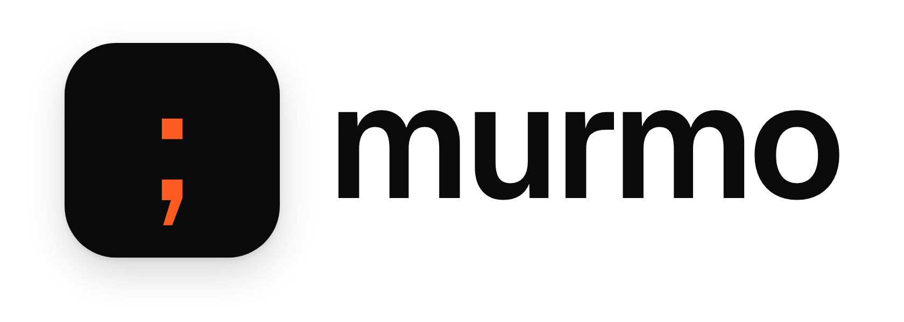

<p align="center">
  
</p>

<p align="center">
  Plugins for your coding agent's prompt box.<br />
  <sub>Claude Code · OpenCode · Pi · Codex CLI&nbsp;&nbsp;|&nbsp;&nbsp;macOS and Linux&nbsp;&nbsp;|&nbsp;&nbsp;Runs locally</sub>
</p>

<p align="center">
  
</p>

<p align="center">
  <a href="media/films/hero.mp4">Watch with sound</a>&nbsp;&nbsp;·&nbsp;&nbsp;<a href="#quick-start">Quick start</a>&nbsp;&nbsp;·&nbsp;&nbsp;<a href="#features">Features</a>&nbsp;&nbsp;·&nbsp;&nbsp;<a href="#shortcuts">Shortcuts</a>&nbsp;&nbsp;·&nbsp;&nbsp;<a href="#plugins">Plugins</a>&nbsp;&nbsp;·&nbsp;&nbsp;<a href="#faq">FAQ</a>
</p>

## Why Murmo

**One file, every agent.** Your shortcuts live in one `murmo.toml`, and Claude Code, OpenCode, Pi and Codex CLI all read it. Murmo runs inside each agent's own prompt box, without patching or forking any of them.

**Nothing leaves your machine.** Murmo makes no network requests of its own. A plugin reaches the network only if you grant it the `network` permission.

**Plugins get only what you allow.** You review a plugin's permissions before it installs, and it runs locked down with exactly those. Plugin code never runs on the keystroke path, so typing never waits for a plugin.

## Quick start

There is no published package yet. Building from this repository needs Node 24, pnpm, Rust (the toolchain in `rust-toolchain.toml`) and OpenSSL.

```sh
tools/offline/fetch.sh                                   # pnpm install + cargo fetch
openssl genpkey -algorithm ed25519 -out murmo-key.pem    # your own signing key
openssl pkey -in murmo-key.pem -pubout -out murmo-key.pub.pem
node tools/pack.mjs --key murmo-key.pem                  # builds dist/release/package
node dist/release/package/cli.mjs setup --key murmo-key.pub.pem
```

Setup finds the agents you have and installs Murmo into each. Start an agent, type `;rvw` and a space.

| Command | What it does |
| --- | --- |
| `murmo doctor` | Shows what is installed and loaded, one line per check. |
| `murmo codex` | Starts Codex CLI with Murmo. |
| `murmo uninstall` | Undoes what setup installed, so your home folder matches how it was before. |

## Features

| Feature | What it does |
| --- | --- |
| **Shortcuts** | Type `;rvw` and a space, and it expands into the full prompt. Backspace right after undoes it. |
| **The `;` menu** | Type `;` and part of a name, alias or description, then pick with the arrows and Enter. |
| **Template fields** | Templates hold `<field>` placeholders with defaults. In Pi and OpenCode, Tab moves between them. |
| **Autocorrect** | Fixes known typos as you finish a word (`teh` becomes `the`) and leaves code, commands, paths, URLs, flags, project names and pasted text alone. Off until you turn it on. |
| **Draft rescue** | If the agent crashes or you quit with an unsent prompt, the next session offers it back. Tab restores it. |
| **Plugins** | `murmo plugin new` starts one; `murmo plugin add` installs it after showing the permissions it asks for. |

### Supported agents

| Agent | Tested versions | Shortcuts | `;` menu | Template fields | Draft rescue | Installed plugins |
| --- | --- | --- | --- | --- | --- | --- |
| Pi | 1.2.0, 1.3.0 | yes | yes | Tab and Shift+Tab | yes | yes |
| OpenCode | 2.1.0, 2.1.1 | yes | yes | Tab | yes | yes |
| Claude Code | 2.1.302 to 2.1.304 | yes | yes | edit by hand | yes | yes |
| Codex CLI | 0.162.1, 0.163.0 | yes | no | edit by hand | no | not yet |

macOS and Linux on arm64, with Node 24.18 or newer. Some limits come from the agents themselves: Claude Code gives plugins no Tab or Escape, so template fields there are edited by hand, and Escape then Enter in its `;` menu needs one extra Enter. OpenCode 2.0.x is not supported.

## Shortcuts

Setup writes `~/.config/murmo/murmo.toml` with two to try. Edits apply without restarting the agent.

```toml
version = 1
[replace]
";tst" = 'Run the test suite, fix failures, and do not edit the tests.'
";rvw" = '''
Review this change for bugs, edge cases and missing tests.
List issues by severity. Be concise.
'''
```

A template holds `<field>` placeholders; a field with a default shows it.

```toml
[replace.";review"]
text = '''
Review <change> for correctness.
Pay particular attention to <concern>.
'''
description = "Code review request"
fields.change = { default = "this change" }
```

Autocorrect is off until you turn it on in the same file.

```toml
[autocorrect]
enabled = true
```

A project shares shortcuts with its team in `.murmo.toml` at its root. They stay off until you review them with `murmo trust`, and a changed file needs your approval again.

## Plugins

```sh
murmo plugin new word-count      # scaffold a plugin that counts the draft's characters
murmo plugin test word-count     # run its tests
murmo plugin dev word-count      # try it in a fake prompt box
murmo plugin add ./word-count    # review its permissions, then install it in your agents
```

A plugin is a manifest, `murmo.plugin.json`, and one ES module. The manifest names each permission the plugin needs and why, such as `draft:read` to see what you type. Start with the [authoring guide](packages/api/docs/AUTHORING.md). The plugin API is a preview until Murmo v1 and can still change.

## FAQ

<details>
<summary><strong>Why not macOS Text Replacements?</strong></summary>
<br />

Murmo's shortcuts work like System Settings → Keyboard → Text Replacements (`omw` becomes `On my way!`), but those apply only in native Cocoa text fields. Terminal apps don't support them, so they never reach a coding agent's prompt box. They are also personal only, with no project file to share, and in practice single-line, and Linux has nothing like them built in. Murmo runs inside each agent's own prompt box, so it works in any terminal, on macOS and Linux alike.

</details>

<details>
<summary><strong>How is a shortcut different from a skill?</strong></summary>
<br />

A skill is for the agent: it teaches the agent how to do a job, like releasing your app or following your team's review checklist, and the agent often decides when to use it. A shortcut is for you: it saves you typing the same request again and again. When you type `;rvw` and a space, the full text appears in your prompt box right away, and you can read it, change it and add your own words before you send it.

The two work well together. Skills hold what the agent knows how to do; shortcuts hold how you like to ask. A shortcut can even ask the agent to use a skill.

</details>

## Development

```sh
pnpm lint && pnpm check   # Biome and TypeScript
pnpm test                 # unit tests, with the network blocked
pnpm test:conformance     # the shared fixtures on every runtime
pnpm rust test --offline  # the Rust helper
```

[CONTRIBUTING.md](CONTRIBUTING.md) covers setup, and [AGENTS.md](AGENTS.md) has the full command list and the rules for changes.
